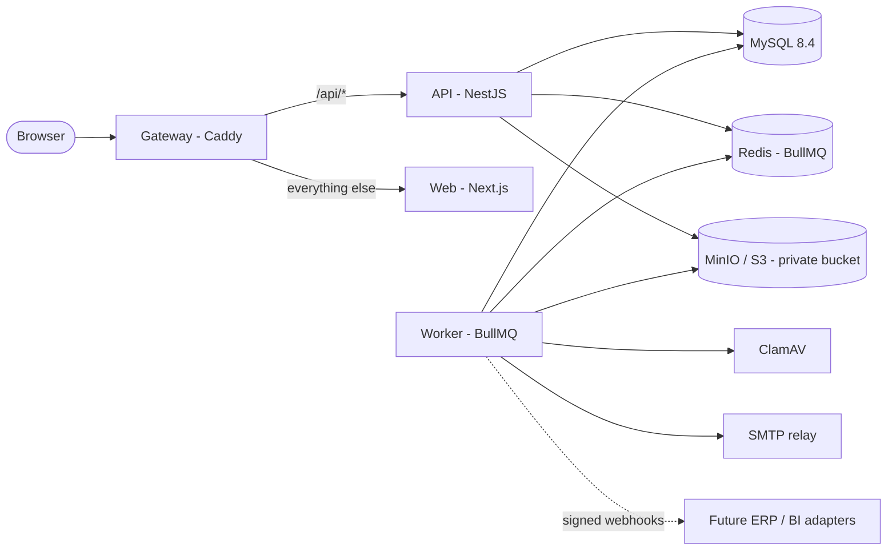

# Architecture

SQMS is a modular monolith: one API process owns all business rules and data access, a worker process runs
asynchronous jobs, and a Next.js application provides the user interface. MySQL is the system of record; binary
files live in S3-compatible object storage.

## Repository layout

| Path | Contents |
| --- | --- |
| `apps/api` | NestJS 11 REST API (`/api/v1`), OpenAPI at `/api/docs`, demo seed, integration tests |
| `apps/worker` | BullMQ worker: malware scanning, email delivery, reminders and escalation, outbox dispatch |
| `apps/web` | Next.js 16 (App Router) user interface; talks only to the API |
| `packages/shared` | Enums, permission catalog, status tones, document-type catalog, applicability rule engine, risk model, native form schemas and validator, settings schemas (used by API, worker and web) |
| `packages/db` | Prisma 7 schema (9 files, 91 models), migrations, MariaDB driver adapter client, reference seed, password hashing |
| `packages/server-core` | Server-side configuration (validated environment), object storage, scanner, mailer, queues, notification catalog |
| `e2e` | Playwright demo tests |
| `infra` | MySQL init/config, MinIO build, Caddy gateway, migration job script |

## API

* **Layers.** Controllers validate input with class-validator DTOs (`whitelist` + `forbidNonWhitelisted`) and
  delegate to services. Services own transactions (`DbService.tx`, READ COMMITTED with explicit `SELECT ... FOR
  UPDATE` row locks on the aggregate being changed) and write audit, activity, notification and outbox records in
  the same transaction.
* **Guards** (global, in order): rate limiting; session resolution with audience enforcement (internal / supplier);
  CSRF; permissions.
  Every query that can return supplier data is scoped server-side through `AccessScope`; identifiers supplied by
  the client never widen access, and records outside the caller's scope are reported as not found.
* **Optimistic concurrency.** Mutable aggregates carry a `version`; updates send `expectedVersion` and get `409
  STALE_VERSION` when someone else changed the record.
* **Errors** use one shape: `{ error: { code, message, details?, correlationId } }`. Stack traces and internal
  details are never returned in production; every response carries an `X-Request-Id` correlation header.
* **Modules:** suppliers, products and configurations, document types (library, templates, native forms),
  documents and files, sourcing projects (wizard, risk, applicability checklist), qualifications (gate, tests, FAI,
  inspection, approval package), change requests, quality (NCR, deviations/concessions, SCAR), workflow
  (approvals), collaboration (tasks, comments, activity, notifications, saved views), administration, audit,
  insights (dashboard, reports, search) and the Phase 2 supplier portal.

## Key domain decisions

* **Supplier approval is not product approval.** A `SupplierQualification` approves a supplier/site; a
  `ProductApproval` approves one `ConfigurationRevision` of a `SupplierProduct` (internal part + supplier part +
  manufacturing site). Approving a supplier never approves its products, and vice versa.
* **Configurations are revisioned.** Each `ProductConfiguration` has revisions with an `EngineeringBaseline`, delta
  `CustomerRequirement`s and `CriticalCharacteristic`s. Only one revision per configuration is authorized at a time
  (`currentApprovedRevisionId`); proposed revisions created by change requests are separate records, and approval
  supersedes (never overwrites) the previous revision and its product approval.
* **Pathways.** A: company-controlled design (optionally reverse engineered from a physical sample). B: supplier
  standard product. C: supplier product plus a delta specification the supplier acknowledges.
* **Applicability engine.** `packages/shared/src/rules/applicability.ts` evaluates versioned policy rules against
  a project context (pathway, risk, criticality, supplier status, ownership, special processes, customer
  requirements, reverse engineering) to produce REQUIRED / CONDITIONAL / NOT_APPLICABLE requirements, each with
  its reason. Projects record the policy version used; waivers require a justification and a permission that
  depends on the level (`project:waive_conditional` / `project:waive_mandatory`).
* **Approval gate.** Product approval (and change approval) is only reachable through submission, which evaluates
  the gate: accepted baseline, acknowledged and verified delta requirements, identified configuration and site,
  supplier status, documentation complete or waived, accepted validation evidence, no blocking NCRs/deviations.
  Status endpoints cannot move a qualification to approved.
* **Approval package.** On approval the exact document revisions (with SHA-256 content hashes), waivers, tests and
  gate result are frozen in an `ApprovalPackage`; its integrity is re-verified when it is viewed.

## Workflow engine

`WorkflowDefinition`s are versioned (new versions apply to new approvals only). Steps with the same order run in
parallel; each step is assigned to a role, a named user or the record owner, with optional due days, escalation
and a condition on the subject context (e.g. management approval only for high risk). Decisions record the exact
subject version reference; self-approval is prevented by a setting that is on by default. Subject handlers
(documents, projects, qualifications, change requests, supplier qualifications, deviations) apply outcomes inside
the deciding transaction.

Seeded definitions: document review (standard, engineering then quality, parallel, management), sourcing intake,
product approval (standard and high risk), supplier change approval, supplier qualification, deviation approval.

## Files

Uploads stream as multipart (never base64) through the API to the private bucket under an opaque key. The API
checks the extension against the allow-list, the declared type, the size limit and the content signature, computes
SHA-256, and stores the object in quarantine (`PENDING_SCAN`). The worker scans it with ClamAV (INSTREAM); only
`CLEAN` files can be attached, previewed or downloaded, and downloads are streamed by the API after an
authorization check. Infected files are marked `INFECTED`, audited and reported to the uploader; scanner failures
are retried and end as `SCAN_FAILED`, never as available.

## Worker

| Queue / schedule | Purpose |
| --- | --- |
| `scan` | ClamAV scanning of new uploads |
| `email` | Email delivery with retries; deliveries are recorded per notification |
| `outbox` (every 15 s) | Dispatches committed domain events to integration adapters (log adapter by default; signed webhook when `OUTBOX_WEBHOOK_URL` and `OUTBOX_WEBHOOK_SECRET` are set) |
| sweeps (1-2 min) | Re-queue pending scans and deliveries after outages |
| task reminders (15 min), approval and SCAR escalation (hourly) | Due-date reminders and escalation to configured roles |
| certification expiry, deviation expiry, supplier metrics (daily, UTC) | Expiry alerts, automatic expiry of time-limited deviations, scorecard metrics |

## Integrations

The application has no direct dependency on SharePoint, Power Apps or ERP systems. Integration happens through the
transactional outbox (`OutboxEvent`) and the `IntegrationAdapter` contract in `apps/worker/src/processors/outbox.ts`;
`ExternalReference` stores identifiers in external systems. Reports export CSV for BI tools.

## Phase 2: supplier portal

Supplier users (`userType = EXTERNAL`), supplier roles, supplier-scoped queries, document sharing and
acknowledgment, SCAR responses and change submissions are implemented and covered by isolation tests, but external
sign-in and all supplier endpoints are disabled while `SUPPLIER_PORTAL_ENABLED=false` (the Phase 1 default). The
production configuration refuses to enable the portal without an external MFA provider.
