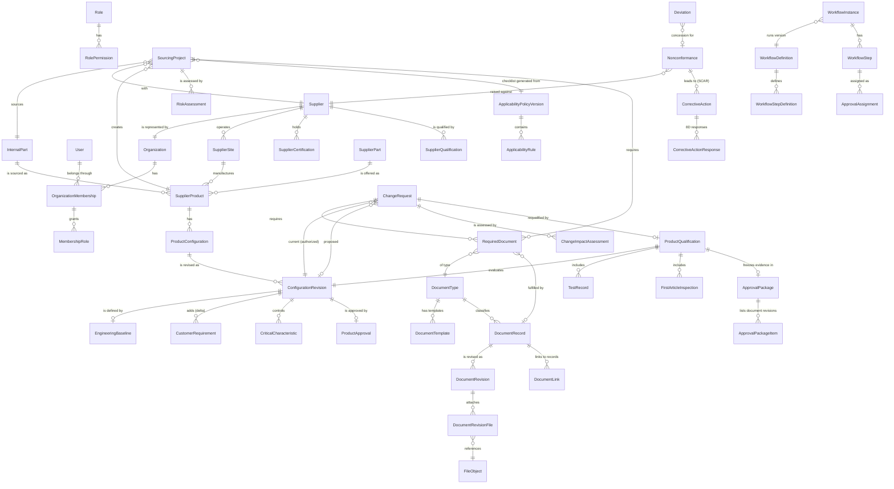

# Data model

The schema lives in `packages/db/prisma/schema/*.prisma` (91 models, 86 enums) and is applied with Prisma
migrations (`packages/db/prisma/migrations`). All tables use UUIDv7 primary keys (`CHAR(36)`), UTC `DATETIME(3)`
timestamps and, for mutable aggregates, an integer `version` used for optimistic concurrency. Binary content is
never stored in MySQL: `file_objects` holds metadata, SHA-256 and scan status, while bytes live in object storage.

| Schema file | Area |
| --- | --- |
| `identity.prisma` | organizations, users, identities, MFA factors (Phase 2), memberships, roles, permissions, invitations, sessions, password resets |
| `suppliers.prisma` | suppliers, addresses, sites, contacts, capabilities, certifications, supplier qualifications, performance metrics |
| `products.prisma` | internal parts, OEM/supplier cross references, supplier parts, supplier products, configurations and revisions, baselines, delta requirements, critical characteristics, product approvals and qualifications, tests, FAIs, inspection, approval packages, change requests, deviations, NCRs, SCARs |
| `sourcing.prisma` | pathways, sourcing projects and members, risk assessments, applicability policies, versions and rules, required documents |
| `documents.prisma` | retention policies, document types, templates and revisions, native form definitions and versions, document records, revisions, files, links, shares, acknowledgments, releases, supersessions, record attachments |
| `workflow.prisma` | workflow definitions and steps, instances, steps, approval assignments, tasks, comments |
| `operations.prisma` | notifications, deliveries and preferences, activity events, audit events, saved views, settings, numbering sequences, outbox, external references |

## Core entities

## Design rules reflected in the schema

* **Supplier vs product approval.** `SupplierQualification` sets the supplier status; `ProductApproval` is unique
  per `ConfigurationRevision` and references the qualification and approval package that justified it.
* **One authorized revision.** `ProductConfiguration.currentApprovedRevisionId` points to the single authorized
  revision; superseded revisions keep `supersededByRevisionId` and their baseline, requirements and approval.
* **Requirement provenance.** `RequiredDocument` stores level, status, source (`POLICY`, `MANUAL` or
  `CHANGE_ASSESSMENT`), the rule and reason that produced it, waiver justification, waiver author and time.
* **Document control.** `DocumentRevision` keeps the content hash computed at submission, the native form schema
  version used, the template revision, and release/supersession/obsolescence dates. Released revisions are never
  edited; new revisions are created instead.
* **Audit.** `audit_events` is append-only: database triggers created by migration `20261015014700_audit_append_only`
  reject `UPDATE` and `DELETE`, and the application account has no DDL rights to drop them.
* **Numbering.** `NumberingSequence` rows are locked when issuing numbers (e.g. `SP-2026-0001`, `DOC-2026-00001`),
  so numbers are unique under concurrency.
* **Retention.** `RetentionPolicy` records trigger and period per category; periods are left empty until records
  management sets them (the system does not assume legal retention periods).
