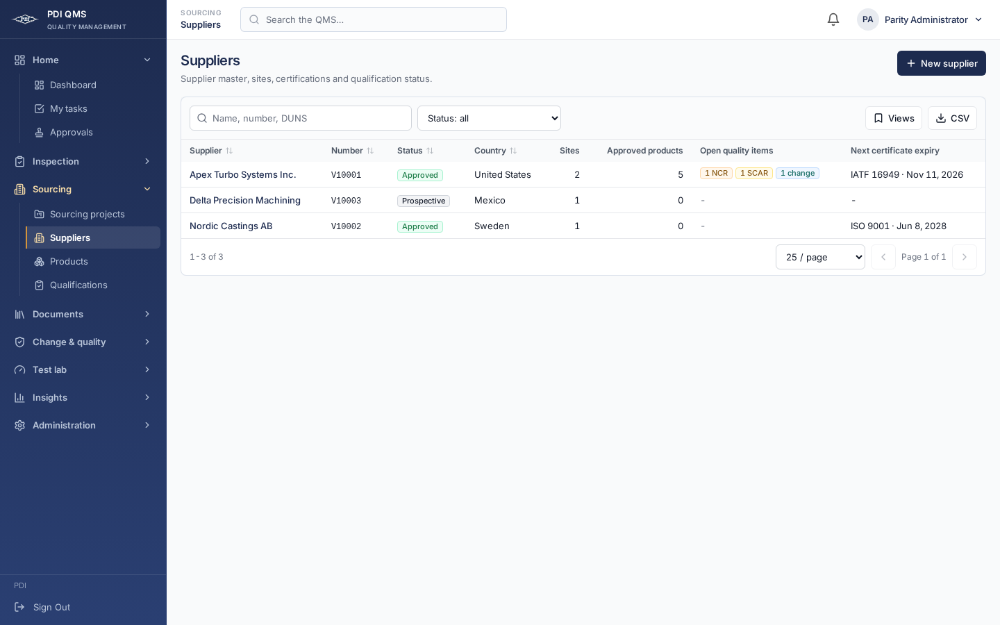

# Engineering workspace

The latest design direction is a clean, focused engineering application with PDI color and character. SQMS grouping and the QMS operational workflows remain in place. This pass refines the presentation and interaction patterns shared by both.

## Visual conventions

- Keep the PDI navy gradient, amber navigation marker, teal selection/hover accents and colored status indicators. White cards and lightly tinted headers provide structure. Color accompanies labels; it does not replace them.
- Use Inter with a 13px compact text scale, 12px labels and 20px page headings. Numeric values use tabular figures; part/vendor identifiers retain monospace treatment. Counts align for comparison.
- Use 6px control radii, 8px panels, fine borders and restrained shadows. Primary actions remain navy, while secondary actions use the PDI frost tint. Links use navy for legibility; amber remains an accent.
- The desktop sidebar is 240px with a compact brand block and tighter navigation rows. The original grouped organization, one active tab, permission visibility and responsive drawer are retained.
- Shared desktop controls use 32–36px compact sizes; copied operational fields retain their original entry sizes. Phones and coarse-pointer touchscreens use at least 44px control heights. Text-entry controls use 16px type on those devices. Reduced-motion preferences suppress control transitions.
- Dashboard metric cards retain their color coding, with consistent color-band alignment when labels wrap.

## Records and forms

Record tables keep identifiers and short values on one line. Description/task/library-name columns explicitly opt into wrapping. Tables scroll within a named, keyboard-focusable region on narrow screens, preserving the surrounding page width. Sorting exposes its state to assistive technology. Existing filtering, saved views, exports, record links and browser-history behavior remain.

Shared form controls, tabs, cards and page headings use the same scale and focus treatment. Long tab sets scroll horizontally. Original workflow screens receive bounded screen-only presentation rules; their fields, calculations and state logic stay copied. NCR report typography is preserved for preview/print, and the API PDF generators are untouched.

The source guard still protects 80 unchanged reference files with six declared integration boundaries. Source preservation does not imply identical rendering: the shared theme intentionally refines density and geometry under the user's latest direction.

## Current previews

All previews contain fictional acceptance data:

[Dashboard](screenshots/engineering-dashboard-desktop.png) · [Parts](screenshots/engineering-parts-desktop.png) · [Original inspection list](screenshots/engineering-inspections-desktop.png) · [Mobile table](screenshots/engineering-suppliers-mobile.png) · [Mobile navigation](screenshots/engineering-navigation-mobile.png)

This is a web-only refinement. Deploy the updated web service against the existing API from merged PR #3; there is no new migration. Render review and operational-data acceptance remain open in [remaining work](remaining-work.md).
