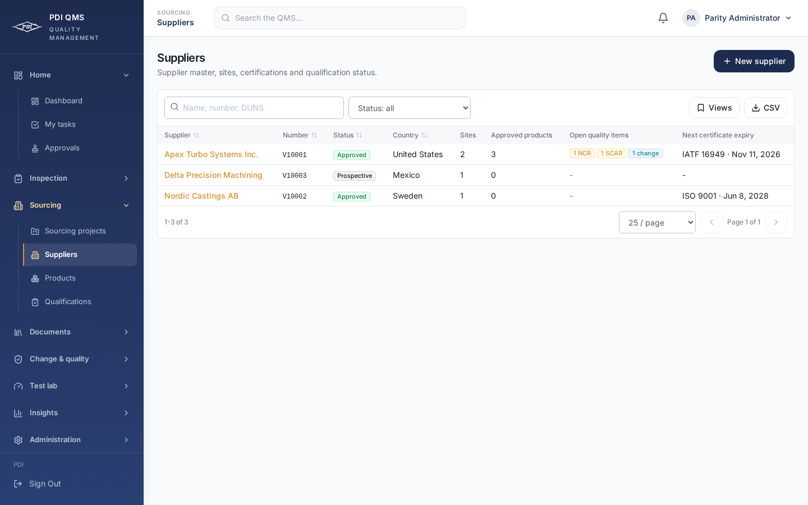

# Shared navigation and QMS theme

The latest user direction replaces exact duplication of the old application layout with SQMS-style organization. The original inspection, NCR and injector workflow pages stay in place; the shared layout is the deliberate exception to source duplication.

The subsequent [engineering workspace refinement](engineering-workspace.md) tightens spacing and controls while retaining PDI color and accents. Its previews supersede the earlier captures below.

## Design

- One shared sidebar/header for the original operational screens and native SQMS modules.
- Stacked, collapsible groups: Home, Inspection, Sourcing, Documents, Change & quality, Test lab, Insights and Administration. Empty groups disappear with their permission-filtered entries.
- Home and the current group open initially. The current group opens on navigation, and one matching tab is highlighted, including nested create/detail pages. Other groups can be opened or closed independently.
- The original QMS navy gradient, amber selection marker, steel text, Inter family, logo, rounded controls, light workspace and white surfaces remain the visual language.
- Global search, notifications and the account menu sit in the header. The original eight-character local-password workflow remains available from Change password; profile/security remains available too.
- Desktop uses a 256px sidebar. Below 1024px, navigation moves into a modal drawer with focus containment, Escape dismissal, focus restoration and body scroll locking. Moving to desktop closes the drawer. Safe-area padding and print rules apply to both module sets.

`components/shell/navigation.ts` owns grouping, labels, permissions and active matching. `AppShell` owns presentation and accepts the original router's navigation adapter. The operational layout supplies the existing toast container and session context. Native pages use the same shell directly. Cross-router links retain normal browser history and modified-click behavior.

NCR reports opens the original narrative/report workflow; Nonconformances opens the structured quality lifecycle. Both remain available under Change & quality. Forms & catalogue opens the original form editor under Inspection; System administration remains separate.

## Acceptance

Current previews use fictional acceptance data:

The [original inspection page](screenshots/grouped-inspections-desktop.png) uses the same shell. Mobile previews show the [page](screenshots/grouped-suppliers-mobile.png) and [navigation drawer](screenshots/grouped-navigation-mobile.png).

Review the desktop and mobile captures and walk through the shared menu on the SQMS test deployment. This UI-only iteration has no database migration. Deploy the web build from this iteration against the API from the merged original-contract PR. Operational data, PDF and complete workflow acceptance remain governed by [remaining work](remaining-work.md).
